# Campus Club Finder: Documentation

This guide walks through the app from a fresh start, page by page, with a screenshot of each step.

Setup instructions are in the [README](README.md).

## 1. Starting state

The first time the app opens:

- There are 5 clubs: Robotics Club, Photography Society, Debate Union, Outdoor Adventure Club, and Film & Media Collective. They come from `src/data/clubs.js`.
- No clubs are joined yet.
- The club list is sorted Name A–Z and shown in Grid view.

## 2. Navbar

Every page has the same navbar at the top. On the left is the app name, which links to Home. On the right are links to **Home**, **Clubs**, and **About**.

The link for the page you're on is highlighted in purple. You can see this change in the screenshots below.

## 3. Home page (`/`)

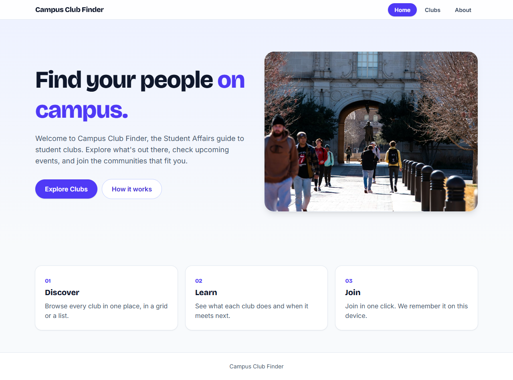

The home page has a welcome message, a short description, and a photo of students on campus.

The **Explore Clubs** button opens the club list. The **How it works** button opens the About page.

## 4. Club list (`/clubs`)

### Grid view, A–Z

All 5 clubs are shown as cards. Each card has the club's image, category, name, short description, and a **View Details** button. Clicking the button, or anywhere on the card, opens that club's page.

### Sorting Z–A

Choose **Name Z–A** in the **Sort by** dropdown and the order flips:

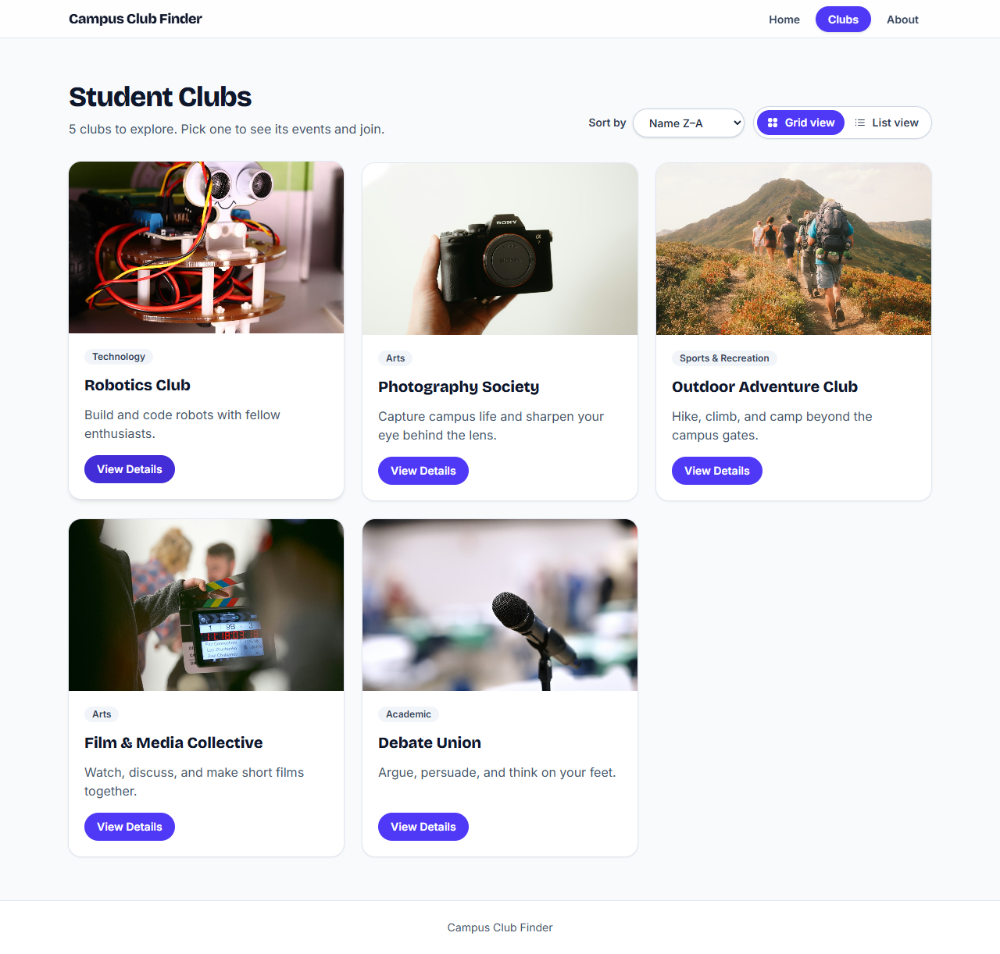

### List view

Click **List view** to stack the cards in one column. The sort order stays the same.

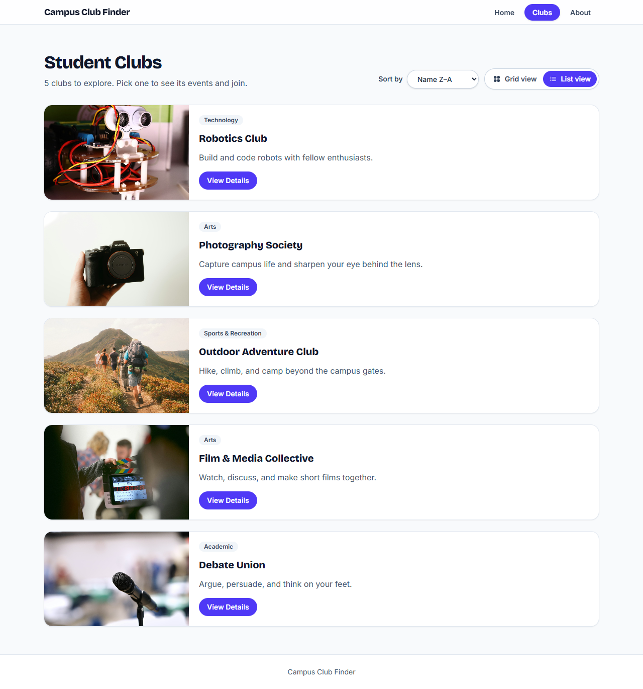

Click **Grid view** to go back.

The sort order and the view are each stored with `useState` in `ClubListPage` and passed down as props to `SortControl`, `ViewToggle`, and `ClubCard`.

## 5. Club detail (`/clubs/:clubId`)

This example is the Robotics Club at `/clubs/robotics`.

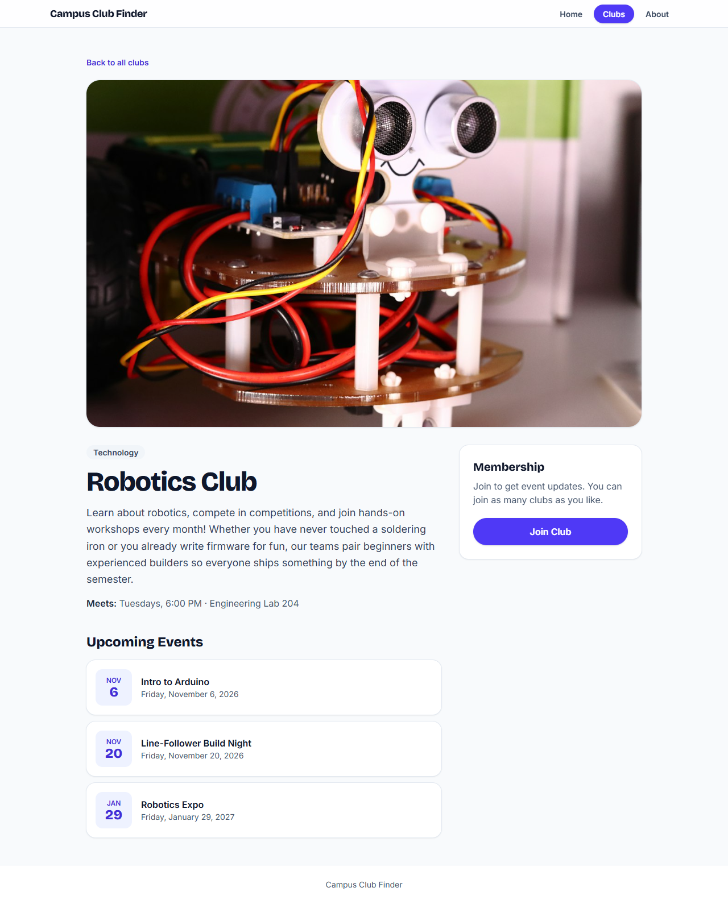

The page shows:

- A link back to all clubs
- A large photo
- The club's category, name, full description, and meeting time
- Upcoming events, sorted by date
- A **Join Club** button

## 6. Joining a club

Click **Join Club**. A welcome message appears, and the button changes to **"You have joined this club!"** and can no longer be clicked.

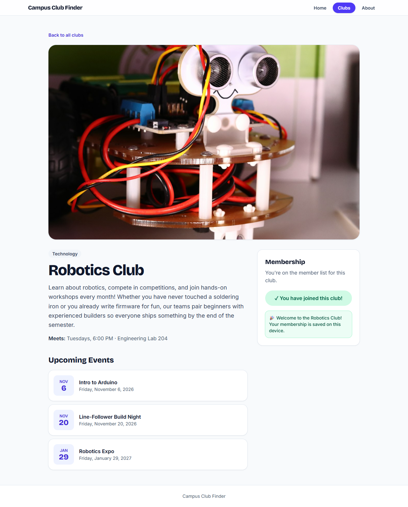

The membership is saved in `localStorage`, so it's still there after reloading the page:

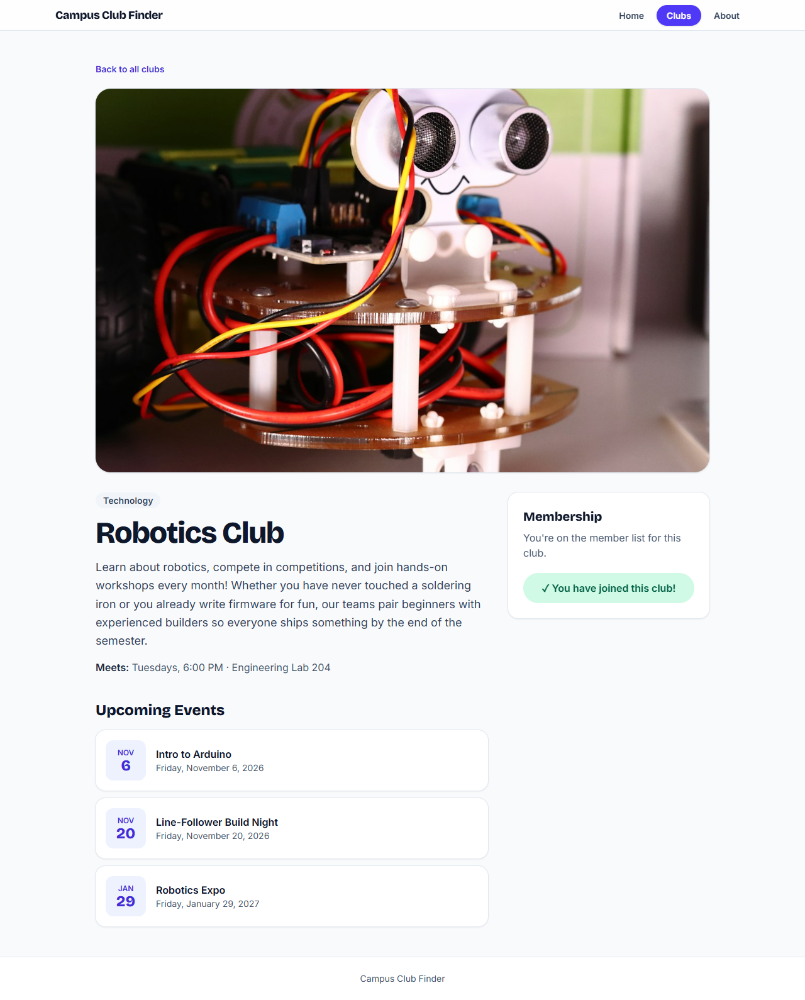

Back on the club list, the joined club now has a **Joined** badge:

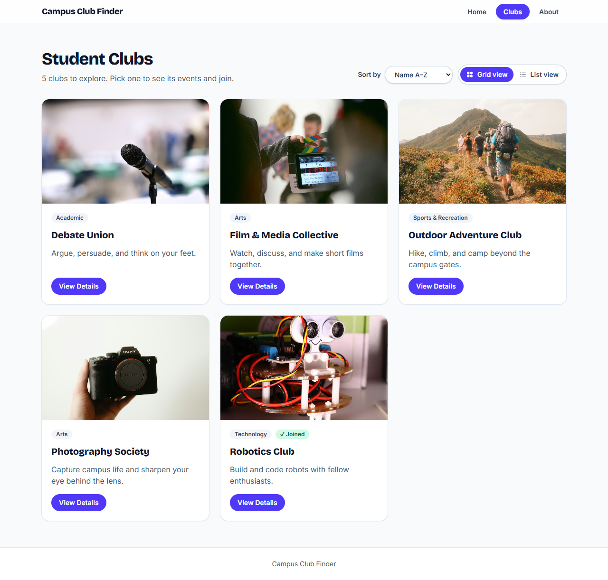

The saved data lives under the key `campus-club-finder:joined-clubs`, for example `["robotics"]`. To start over, run `localStorage.clear()` in the browser console and reload.

## 7. About page (`/about`)

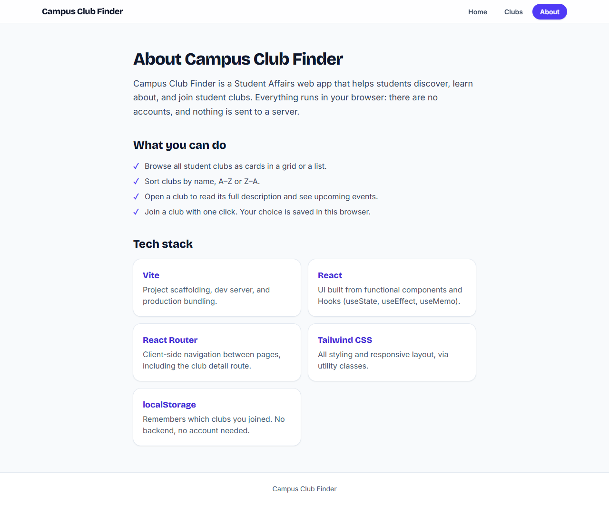

The About page explains what the app does and lists the tech stack.

## 8. 404 page

Any address that doesn't exist shows a friendly message and a **Back to Home** button:

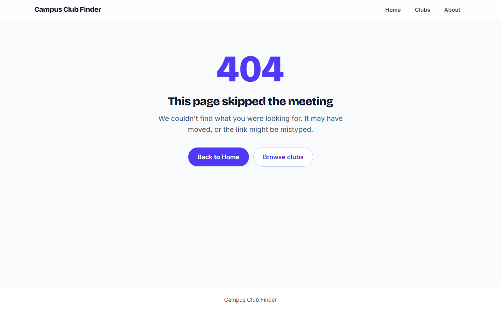

A club that doesn't exist, such as `/clubs/chess`, shows the same page:

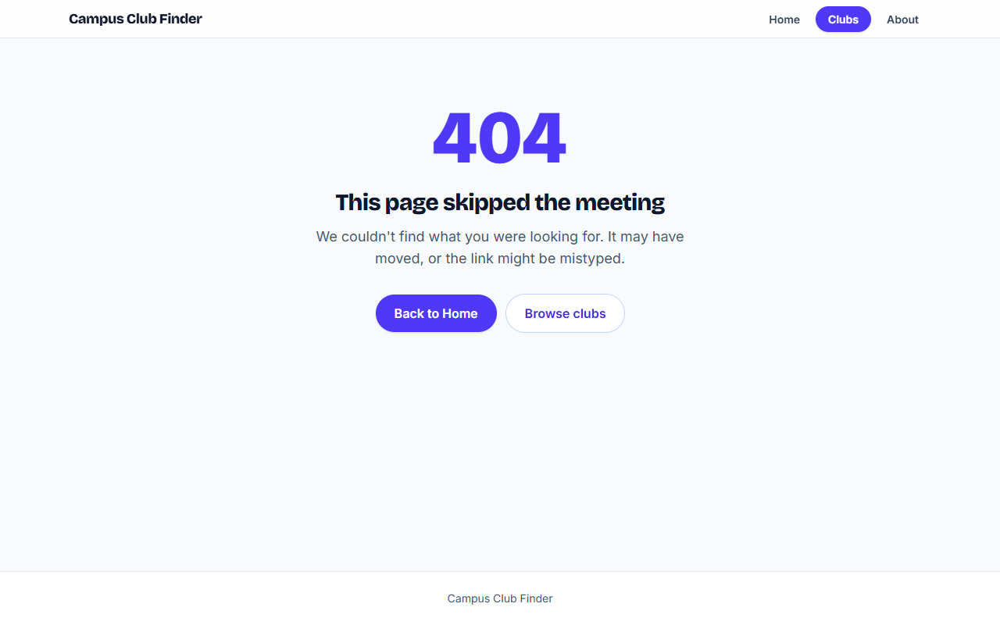

## 9. Mobile and tablet

The layout changes with screen size:

- **Phone:** one column. In list view, the image sits above the text.
- **Tablet:** two columns in grid view.
- **Desktop:** three columns in grid view. On a club page, the Join panel sits beside the description.

Tablet:

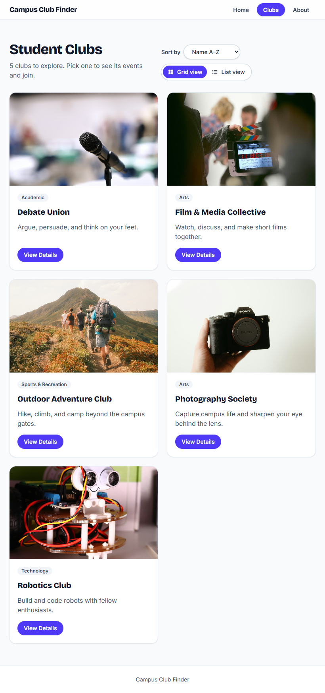

Phone (home, club list in grid and list view, club page):

  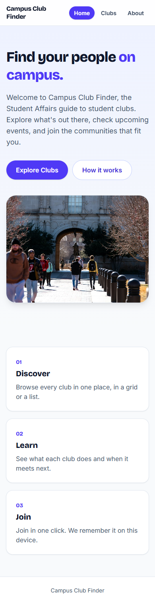
  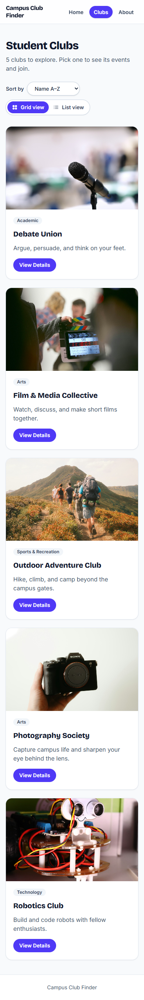
  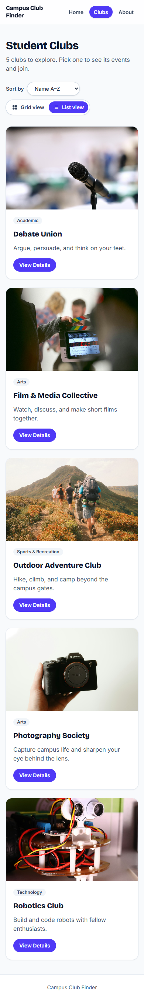
  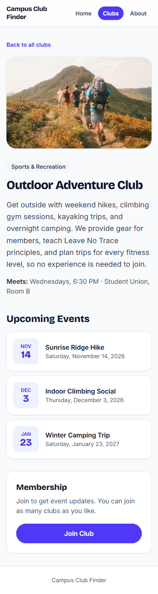

## 10. Accessibility

- Everything works with the keyboard, and the focused item shows a clear outline:

  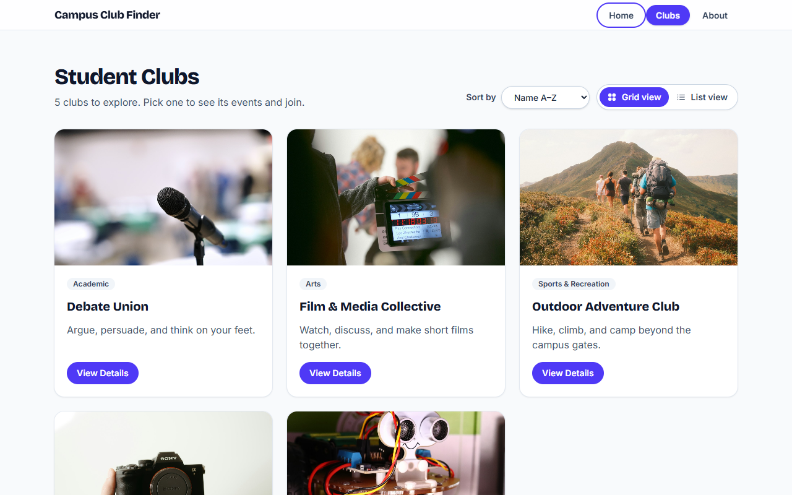

- Pressing <kbd>Tab</kbd> first shows a "Skip to content" link.
- Screen readers are told which page is current, which view is active, and when a club has been joined.
- Every page has its own browser tab title.
